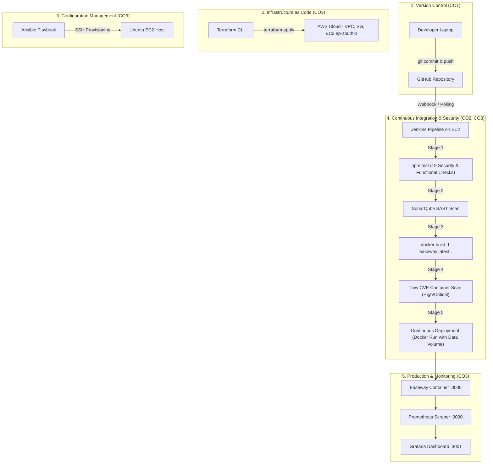

# DevSecOps Lab Micro-Project Report

## Project Title: End-to-End DevSecOps Pipeline & Deployment for "Easeway" (Student Mental Wellness Support Platform)

**Institution:** Shah & Anchor Kutchhi Engineering College (SAKEC)  
**Department:** Department of Cyber Security / Computer Engineering  
**Subject:** DevSecOps Lab (Bachelor of Technology)  
**Academic Alignment:** University of Mumbai Syllabus — Course Outcomes CO1, CO2, CO3 (Experiments 1 to 10)  

---

## 1. Executive Summary

This micro-project implements a complete, production-grade **DevSecOps lifecycle** for **Easeway**, a privacy-first web platform facilitating anonymous mental wellness check-ins, self-help resources, and confidential student-counsellor appointments.

The project demonstrates the convergence of **Infrastructure as Code (Terraform)**, **Automated Configuration Management (Ansible)**, **Continuous Integration & Automated Testing (Jenkins & GitHub Actions)**, **Containerization (Docker)**, **Shift-Left Security & Vulnerability Scanning (Trivy, SonarQube, Threat Dragon)**, and **Continuous Monitoring (Prometheus & Grafana)** deployed on AWS EC2.

---

## 2. Mapping to SAKEC DevSecOps Syllabus & Course Outcomes

| Syllabus Lab Experiment | Topic & Objective | Course Outcome | Implementation in Easeway Project |
|---|---|---|---|
| **Exp 1 & 2** | Version Control using Git & GitHub operations | **CO1** | Git repo initialization, branch protection, feature branches, and `.gitignore`. |
| **Exp 3 & 5** | Jenkins Declarative CI/CD Pipelines & Automated Testing | **CO2** | [`Jenkinsfile`](./Jenkinsfile) declarative pipeline executing 19 automated integration and security test cases (`npm test`). |
| **Exp 4** | Automated Quality Gates & Tests | **CO2** | Test execution in ephemeral environment verifying API contracts, RBAC, and zero-PII storage. |
| **Exp 6 & 7** | Docker Containerization & Lifecycle Management | **CO3** | Multi-stage, non-root [`Dockerfile`](./Dockerfile) and [`docker-compose.yml`](./docker-compose.yml) with data volume persistence and healthchecks. |
| **Exp 8** | Vulnerability Analysis with Trivy / Snyk & SonarQube SAST | **CO3** | Aqua Trivy container scanning + SonarQube static code quality gates integrated into CI/CD. |
| **Exp 9** | Threat Modeling using STRIDE & Threat Dragon | **CO3** | Comprehensive [`security/THREAT_MODEL.md`](./security/THREAT_MODEL.md) documenting DFD, attack vectors, and mitigations. |
| **Exp 10 (Micro-Project)** | End-to-End Infrastructure Provisioning, Deployment & Monitoring | **CO1, CO2, CO3** | - **Terraform**: AWS VPC, Subnet, IGW, Security Groups, EC2.<br>- **Ansible**: Automated Docker setup and app deployment.<br>- **Prometheus & Grafana**: System and health metrics monitoring. |

---

## 3. Architecture & End-to-End Workflow



---

## 4. Component Details & Artifacts

### 4.1. Containerization (`Dockerfile` & `docker-compose.yml`)
- Base image: `node:20-bookworm-slim` for minimized attack surface.
- Native dependency compilation for `better-sqlite3` SQLite driver.
- Execution under non-privileged user (`USER node`).
- Persistent volume mapped to `/app/data` to preserve database and encryption keys across container redeployments.
- Docker native `HEALTHCHECK` polling `/api/me`.

### 4.2. Automated Testing Suite (`test.js`)
- Runs 19 automated checks mapping to test cases TC-01 through TC-10:
  - **TC-01, 01b, 01c**: Registration handles, rejection of emails (`@`), mandatory consent.
  - **TC-02, 02b, 02c**: Mood logging, authenticated AES-256-GCM note encryption at rest.
  - **TC-04**: Role-based access control (students cannot access counsellor endpoints; counsellors cannot submit moods).
  - **TC-05, 05b**: SQL injection resistance and CSRF header verification (`X-Requested-With: easeway`).
  - **TC-08**: k-Anonymity privacy enforcement (`K_THRESHOLD = 5`).
  - **TC-10**: Log sanitation (no PII, request bodies, or notes logged).
  - **SEC-1 & SEC-2**: Security headers (CSP, nosniff, no X-Powered-By) and brute-force login rate limiting.

### 4.3. Infrastructure as Code (`terraform/`)
- Located in [`terraform/`](./terraform/):
  - `provider.tf`: AWS provider targeting `ap-south-1` (Mumbai).
  - `networking.tf`: Custom VPC (`10.0.0.0/16`), public subnet (`10.0.1.0/24`), Internet Gateway, route tables.
  - `security_group.tf`: Restrictive ingress for SSH (22), HTTP (80), HTTPS (443), Easeway (3000), Jenkins (8080), SonarQube (9000), Prometheus (9090).
  - `ec2.tf`: Ubuntu 22.04 LTS instance with automated Docker Engine cloud-init bootstrap.
  - `outputs.tf`: Public IP, DNS, and application URLs.

### 4.4. Automated Configuration (`ansible/`)
- Located in [`ansible/`](./ansible/):
  - `inventory.ini`: Target server configuration.
  - `playbook.yml`: Automated installation of Docker Engine, Docker Compose, system dependencies, directory permission setup (`0700` for keys), and container startup.

### 4.5. Continuous Monitoring (`monitoring/`)
- Located in [`monitoring/`](./monitoring/):
  - `prometheus.yml`: Scrapes metrics from `node_exporter` (CPU, memory, disk, network) and `easeway_app`.
  - `docker-compose.monitoring.yml`: One-command stack deploying Prometheus (:9090), Node Exporter (:9100), and Grafana (:3001).

---

## 5. Step-by-Step Execution Guide for Evaluation / Demo

### Step 1: Run Automated Verification Locally
```bash
# Run 19 automated integration and security tests
npm test
```
*Expected Result:* `19/19 checks passed` with exit code `0`.

### Step 2: Build and Test Docker Container Locally
```bash
# Build the Docker image
docker build -t easeway:latest .

# Run container with persistent data volume
docker run -d --name easeway-app -p 3000:3000 -v easeway-data:/app/data easeway:latest

# Verify running container and healthcheck
docker ps
curl http://localhost:3000/api/me
```

### Step 3: Provision AWS Infrastructure via Terraform
```bash
cd terraform
terraform init
terraform plan
terraform apply -var="key_name=your-aws-key"
```

### Step 4: Configure Host & Deploy via Ansible
```bash
cd ../ansible
# Update inventory.ini with EC2 public IP from Terraform output
ansible-playbook -i inventory.ini playbook.yml
```

### Step 5: Execute Jenkins DevSecOps Pipeline
1. Open Jenkins at `http://<EC2-PUBLIC-IP>:8080`.
2. Create a new Pipeline Job: `easeway-devsecops-pipeline`.
3. Select "Pipeline script from SCM" -> Git -> Enter your repository URL.
4. Click **Build with Parameters** -> Run.
5. Inspect the stages: Checkout -> Automated Tests -> SonarQube -> Docker Build -> Trivy Security Scan -> Deploy.
6. View the published **Trivy Security Scan Report** in the Jenkins build sidebar.

### Step 6: Launch Monitoring Stack (Prometheus & Grafana)
```bash
cd monitoring
docker compose -f docker-compose.monitoring.yml up -d
```
- Open Prometheus: `http://<EC2-PUBLIC-IP>:9090` (Targets status: healthy).
- Open Grafana: `http://<EC2-PUBLIC-IP>:3001` (Default login: `admin` / `admin`).

---

## 6. Conclusion

The Easeway DevSecOps project achieves all objectives of the SAKEC DevSecOps laboratory syllabus. It establishes a repeatable, secure, and observable software delivery pipeline that shifts security left into early pipeline stages while maintaining the high privacy and ethical requirements of student mental health data.
