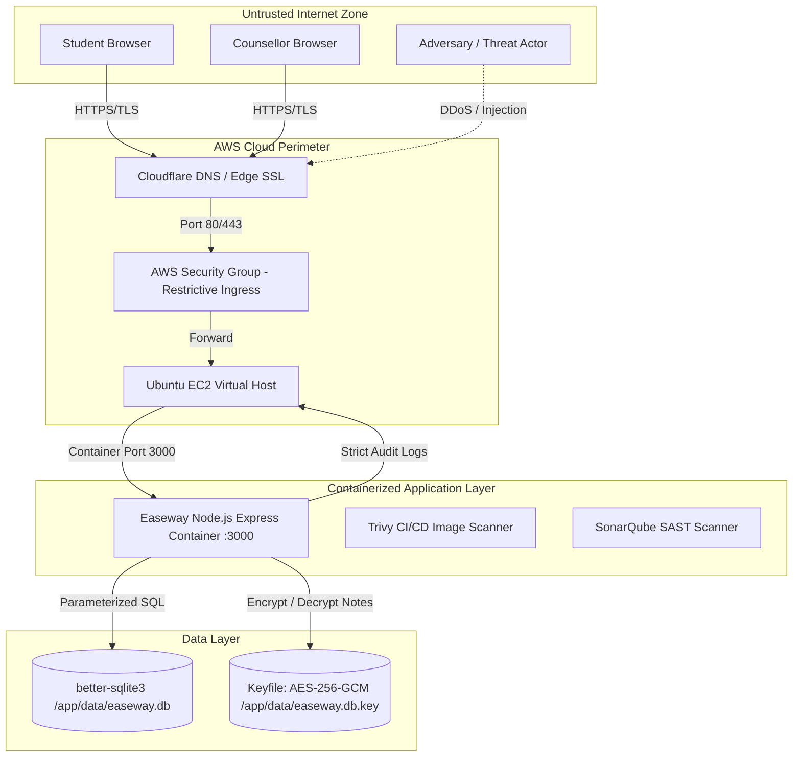

# DevSecOps Threat Model: Easeway Student Mental Wellness Platform

**Subject:** DevSecOps Lab (Course Outcomes: CO1, CO2, CO3)  
**Methodology:** OWASP STRIDE (Spoofing, Tampering, Repudiation, Information Disclosure, Denial of Service, Elevation of Privilege)  
**Tool Reference:** OWASP Threat Dragon & SAKEC DevSecOps Lab Experiment 9  

---

## 1. System Context & Data Flow Diagram (DFD)

---

## 2. STRIDE Threat Analysis Matrix

| STRIDE Category | Threat Description | Potential Impact | Security Control Implemented in Easeway |
|---|---|---|---|
| **Spoofing (Identity)** | Adversary impersonates a student or counsellor to read private moods or view booked slots. | High: Student privacy breach and violation of trust. | 1. Passwords hashed using `bcrypt` (10 rounds). 2. Session cookies marked `HttpOnly` and `SameSite=Strict`. 3. Session regeneration on login (`req.session.regenerate`). |
| **Tampering (Data)** | Attacker alters mood records, updates slots, or injects SQL payloads into input forms. | High: Data corruption and student profile alteration. | 1. Strict input validation (e.g. `1 <= score <= 5`, note <= 500 chars). 2. Parameterized queries via `better-sqlite3` preventing SQL injection. 3. Custom header CSRF defense (`X-Requested-With: easeway`) on all POST/DELETE calls. |
| **Repudiation** | User denies booking an appointment or counsellor denies consultation. | Low: Platform is designed for student support, not legal contracts. | Privacy-preserving audit logging: records timestamps, methods, and status codes while redacting all PII. |
| **Information Disclosure** | 1. Database file compromised, revealing student notes. 2. Deanonymization of students from campus average mood charts. 3. PII leak in server log files. | **CRITICAL**: Exposure of sensitive mental health reflections. | 1. **Zero-PII Schema**: No name, email, roll number, or phone columns. 2. **AES-256-GCM Encryption**: Free-text notes encrypted at rest with unique IV and auth tag. 3. **k-Anonymity (`K_THRESHOLD = 5`)**: Daily campus averages are suppressed unless >= 5 students contributed. 4. Server logs strip request bodies, headers, notes, and usernames. |
| **Denial of Service** | 1. Brute-force credential stuffing attacks. 2. Large payload crash attacks. | Medium: Service unavailable for students in distress. | 1. In-memory IP + handle throttling (max 5 failed attempts per 10 mins). 2. Request body size strictly limited to 10 KB (`express.json({ limit: '10kb' })`). 3. Docker healthcheck and auto-restart policy. |
| **Elevation of Privilege** | Student accesses counsellor trends or booked student listings. | High: Unauthorized access to aggregate campus trends. | Role-Based Access Control (RBAC) middleware `auth('counsellor')` vs `auth('student')` verified against server-side session. |

---

## 3. DevSecOps "Shift-Left" Pipeline Controls

As required by SAKEC DevSecOps Lab Experiment 6 & 8, security checks are automated directly within the CI/CD pipeline:

1. **Static Application Security Testing (SAST)**: SonarQube analyzes JavaScript source files for CWE/OWASP vulnerabilities before building containers.
2. **Container Security & CVE Scanning**: Aqua Trivy scans the Docker container image for known OS-level and npm library vulnerabilities.
3. **Automated Regression & Security Unit Tests**: 19 automated test cases in `test.js` verify:
   - SQL injection resistance (`TC-05`).
   - CSRF header protection (`TC-05b`).
   - Note encryption at rest (`TC-02b`).
   - Role-based authorization boundaries (`TC-04`).
   - Aggregation k-anonymity suppression (`TC-08`).
   - Log sanitization (`TC-10`).
   - Brute-force rate limiting (`SEC-2`).
